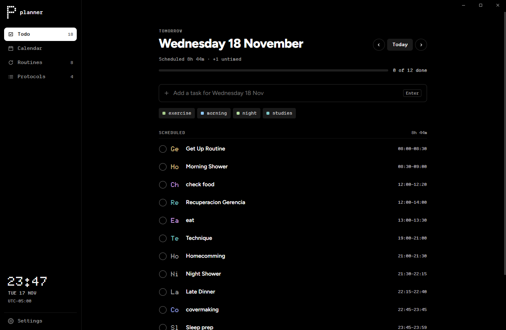
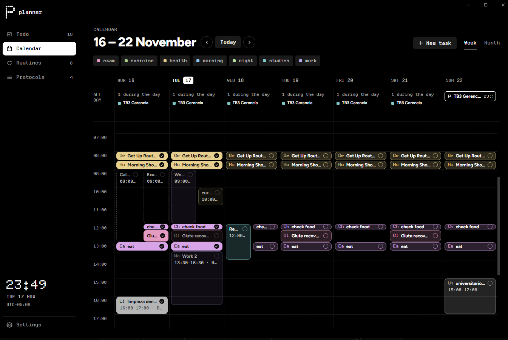
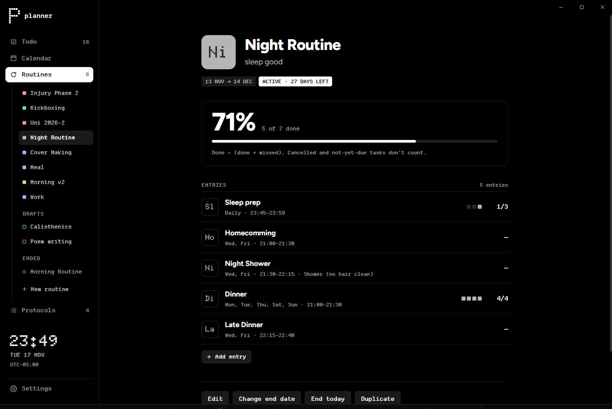
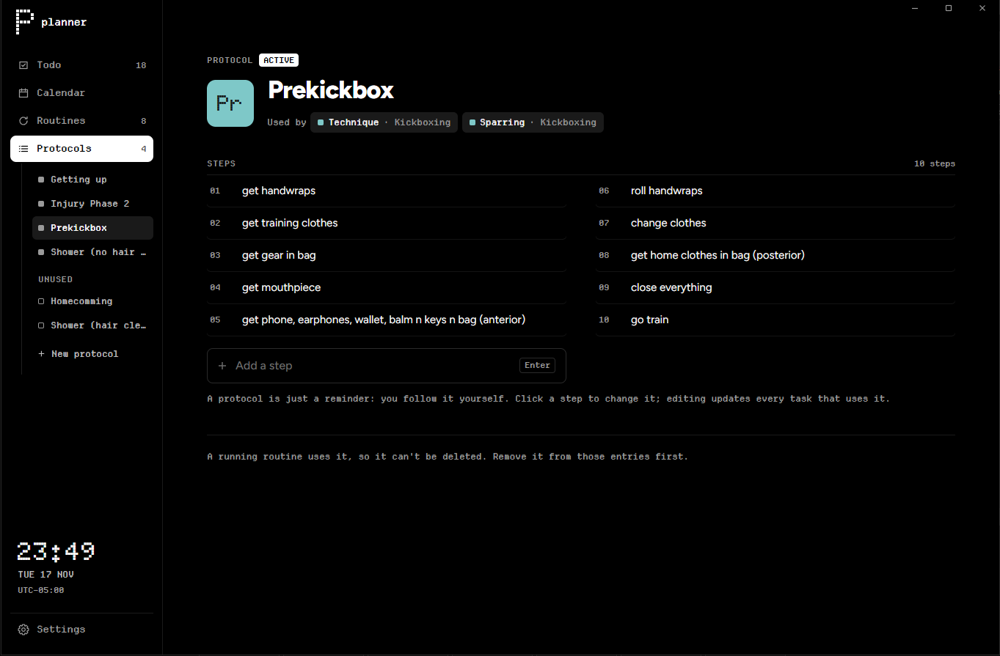

# neos-own-planner

An easy-to-use planner where everything you do is a **task**, and anything in your life that repeats can be set up once and left to run.

It's an extended todo app. On top of a plain todo list it adds **routines** (the repeating parts of life: classes, exercise, daily habits) and **protocols** (the steps for doing something). Journaling is planned.



> **Status: v0.1, the first working version of the desktop app for Windows.** Tasks, routines, protocols and tags are all real, saved on your computer and kept across restarts. Next: fixing what daily use turned up on desktop, then the mobile app and sync between devices. See [Roadmap](#roadmap).
>
> **Download:** the Windows installer is on the [Releases page](https://github.com/NeoRise456/neos-own-planner/releases/latest) (`.msi`, or the `-setup.exe`). It isn't code-signed yet, so Windows SmartScreen may warn: *More info → Run anyway*.

## Screenshots

| Calendar | Routines |
|---|---|
|  |  |
| **Calendar.** The week at a glance: timed tasks as blocks (side by side when they overlap), all-day tasks and deadlines on top, a now line. Click an empty slot to add a task there. | **Routines.** A purpose, a fixed period and its entries. Consistency is one honest number: done ÷ (done + missed). |

| Protocols | |
|---|---|
|  | **Protocols.** The steps for doing something ("Prekickbox": 10 steps), shared by any number of tasks and routine entries. Just a reminder: the app never times them or checks steps off. |

## Why

Most planners split your life into separate kinds of things (events, habits, chores, reminders), each with its own rules. This one has **one unit**, the task, and every task works the same way wherever it comes from. Repetition is deliberate: things only repeat inside a routine, and every routine has an end date, because life changes too much to keep one forever. Missing something is shown as a plain fact, never as a guilt trip.

## Core concepts

The full definitions live in [`docs/`](docs). This is the short version.

### Task: the only thing that gets done
A single real-life action: "Buy milk", "Dentist Thu 15:00", "Gym on Monday". Only the title is required; it can also have notes, tags, a duration, a start and a due date/time, and one protocol.

- **Kind**, worked out from its dates, never chosen:
  - **anytime**: no date ("Buy milk")
  - **floating**: a day but no time ("Reply to email today")
  - **timed**: a start time ("Dentist 15:00")
- **State**: always one of four.
  - **not done**
  - **done**
  - **missed**: its time ran out; you can still tick it later
  - **cancelled**: it won't happen, and it isn't your fault

  There is no "overdue" or "late".
- **A task never repeats.** It is always one action at one point in time.

→ [`docs/TASK.md`](docs/TASK.md)

### Routine: where repetition lives
A container with a **purpose** ("Get stronger and have more energy") and a fixed **period** (start and end date, both required).

Examples: "Exercise plan", "Morning routine", "Uni — Term 1".

- A new routine is a **draft**: set it up freely, nothing shows yet. **Publish** it and its tasks start from that day.
- You **end** a routine to stop it, which keeps its history. You **duplicate** it (into a new draft) to start again.
- It tracks one number, **consistency** = done ÷ (done + missed).

### Routine entry: the blueprint
A recipe inside a routine: what to do and when it repeats. Examples:
- "Gym, Mon/Wed/Fri at 18:00, 1 h"
- "Water, 4 times a day"

An entry produces **one task per occurrence**. Changes to an entry apply from today on, so history stays true.

→ [`docs/SYSTEMS.md`](docs/SYSTEMS.md)

### Protocol: how to do it
An ordered list of plain-text steps ("Shower": 16 steps). One protocol can be shared by many tasks and entries. It's just a reminder: the app doesn't time it or check steps off. It's **active** while a running routine uses it, **past** once only finished routines did, and **unused** otherwise. Past ones can be searched and used again; only unused ones can be deleted.

### Time zone
A setting that moves "now": the calendar's now line, which day is today, and when time runs out. It never changes the times you gave your tasks.

## Views

- **Todo**: today by default, day by day. Its sections are Missed, Scheduled, During the day and Anytime, plus collapsible Done and Cancelled lists.
- **Calendar**: week and month. Timed tasks show as blocks (side by side when they overlap), with a "now" line, deadlines and the tasks that run through the day. Click an empty slot to add a task there.
- **Routines**: purpose, period, entries and consistency.
- **Protocols**: the steps, and where each protocol is used.
- **Settings**: the time zone, list defaults, open at startup, and your tags (rename, recolor, merge, delete).

## How it's built

- **The rules are one pure TypeScript package** (`packages/core`): task states, when time runs out, which days a routine entry hits, consistency, what may be deleted. No storage, no UI, and "now" is always passed in, so every rule is tested (208 tests) and the future mobile and web apps get the exact same behaviour.
- **Routine tasks are produced, not stored.** An entry like "Gym Mon/Wed/Fri" isn't written out as hundreds of rows: its tasks are worked out on the fly for the days on screen. A task is saved only the first time you touch it (tick, move, cancel), under a stable id derived from the entry and the day, so it's never doubled.
- **Changes never rewrite the past.** Editing an entry in a running routine adds a new version from today on; earlier days still show what was really planned.
- **Local-first, sync-ready.** Data is SQLite on the device through PowerSync, so the app works fully offline. The schema and ids are already shaped for sync (PLAN.md §7), so turning it on later needs no migration. The desktop database was picked in a small spike (the PowerSync Tauri plugin vs the web SDK in WebView2): only the plugin kept the same data between a dev build and the installed app.
- **Plain SQL, no ORM.** Each read is a live query (SQL + a mapper into core's types); writes load → ask core → update only the columns that changed. The repositories are tested on real SQLite (46 tests).
- **Own design system.** Dark only, a pixel-flavoured UI font (Departure Mono) next to Figtree, 16 color tones plus custom colors, and hand-made date, time, tag and color pickers instead of the browser's. A frameless window with its own title bar. See [`DESIGN.md`](DESIGN.md).

**Stack:** Tauri 2 (Rust + WebView2), React 19, TypeScript, Vite, TanStack Router, Tailwind CSS 4, Radix UI, Zustand, date-fns, PowerSync (SQLite), Vitest.

## Run it locally

This is a **pnpm monorepo**, built so that desktop, mobile and web can share the same rules (`packages/core`) and data code (`packages/data`). **Right now only the desktop app exists**, and it targets **Windows**.

### Prerequisites
- [Node.js](https://nodejs.org) LTS and [pnpm](https://pnpm.io) 10 (`npm i -g pnpm`)
- [Rust](https://rustup.rs) (stable, via rustup)
- [Microsoft C++ Build Tools](https://visualstudio.microsoft.com/visual-cpp-build-tools/), with the "Desktop development with C++" workload
- [LLVM](https://github.com/llvm/llvm-project/releases) (`winget install LLVM.LLVM`): the PowerSync plugin needs its `libclang` to build
- WebView2 (already part of Windows 10/11)

See Tauri's [prerequisites guide](https://v2.tauri.app/start/prerequisites/) if anything is missing.

### Commands
From the repo root:

```bash
pnpm install
pnpm dev                   # the desktop app (same as dev:desktop)
```

The first `pnpm dev` compiles the Rust side and takes a few minutes; after that it starts in seconds with hot reload.

| Command | What it does |
|---|---|
| `pnpm dev:desktop` | The desktop app in its own window (Tauri) |
| `pnpm dev:desktop:browser` | The same UI in a browser, without Tauri: http://localhost:1420 (no window buttons) |
| `pnpm build:desktop` | Windows installer (`.msi` / `.exe`) in `apps/desktop/src-tauri/target/release/bundle` |
| `pnpm test` | Run every package's tests (the rules in `packages/core`, the repositories in `packages/data`) |
| `pnpm check` | Build every app, type-check every package and run the tests |

Commands are named `<task>:<app>`, one pair per platform. When mobile and web exist they'll get `dev:mobile` / `build:mobile` and `dev:web` / `build:web`.

Everything is saved in a SQLite file: `%APPDATA%\com.neo.planner\planner-dev.db` while developing, `planner.db` in the installed app (separate, so testing never touches your real tasks). Nothing leaves your computer.

<details>
<summary><b>What to try</b></summary>

| Screen | Try |
|---|---|
| **Todo** | quick-add (Enter; on a later day it lands on that day) · tick / untick · click a title → task panel: Done/Undo, Move, Edit (notes, tags, start, due, duration), Cancel (Undo in the toast) · on a done task: **Done → Change** its time · Edit → Delete (Undo in the toast) · tag chips → only that tag's tasks · in the panel or Edit, type in **Tags**: it searches your tags (↑ ↓ + Enter), or ends with *Create “…”* · move a task to yesterday → it shows in **Missed** → tick it → *Done now / on time / Pick a time* · ‹ Today › or click the date to jump to any day · restart the app: everything is still there |
| **Calendar** | ‹ Today › weeks · click an empty slot → New task at that time · hover a day's all-day cell → **+** for a task that day · **New task** button · click a block, deadline or row → the task panel (tick, move, edit) · tag chips filter · now line · Week / Month (click a day in Month → its week) |
| **Routines** | **New routine** (a draft) → **Add entry**: Gym weekly Mon/Wed/Fri at 18:00, 1h, with a protocol; Water daily, a count of 4 → **Publish** → its tasks show in Todo and Calendar from today ("Water 2/4" is one row) · tick or move one → it's saved (a moved one says "moved from Fri") · consistency and each entry's recent squares · change an entry (applies from today on) · *Back to draft* / *Delete* only while nothing is done · **End today**, Change end date, **Duplicate** (→ a new draft) |
| **Protocols** | **New protocol** → add steps (Enter) · click a step to edit it · hover → remove (Undo) · rename by clicking the title · sidebar groups active / unused / past · pick one in an entry or a task (**+ Add a protocol**) → its steps show in the task panel · Delete (only unused ones) |
| **Settings** | time zone (moves the sidebar clock and the calendar now line) · list defaults · open when the computer starts (installed app only) · **Tags**: rename, recolor, merge (rename to an existing name), delete (Undo), add · link to the component sheet |
| **/components** | every base component, clickable |

</details>

## Project structure

```
neos-own-planner/
  docs/                PLAN.md (architecture), TASK.md, SYSTEMS.md (product rules)
  design/              the design handoff (DESIGN.md, tokens.css, screens/), brand/ (logo)
  PRODUCT.md           product summary for design reviews
  DESIGN.md            the design system as built
  screenshots/         the images in this README
  packages/
    core/              the business rules, shared by every app (tested with Vitest)
    data/              the database schema and repositories (PowerSync), shared by every app
  apps/
    desktop/           Tauri 2 + React + TypeScript + Vite
      src/
        routes/        TanStack Router pages: todo, calendar, routines, protocols, settings
        components/    ui/ (base components) and app/ (sidebar, task row and panel, dialogs)
        stores/        UI state (Zustand)
        lib/           opening the database, the clock, how a task is shown
        styles/        design tokens + Tailwind CSS 4
      src-tauri/       Rust side (window, icons, permissions, the PowerSync plugin)
```

## Roadmap

From [`docs/PLAN.md`](docs/PLAN.md) §14.

**v0.1 — first working desktop app (Windows) ✅**

1. **UI on mock data**: the whole desktop UI, clickable ✅
2. **Core rules**: everything in TASK.md and SYSTEMS.md as tested TypeScript in `packages/core` ✅
3. **Data layer**: SQLite on the device through the PowerSync Tauri plugin, local only; one-off tasks and tags ✅
4. **Todo** ✅, **Calendar** ✅, **Routines & Protocols** ✅ on real data

**Next**

5. **Desktop fixes** ← we are here: the problems daily use of v0.1 turned up, plus the desktop extras (tray icon, global quick-add shortcut, remembered window position)
6. **Mobile app + sync**: an Android app (React Native / Expo) on the same `core` and `data` packages, and sync & login through a self-hosted PowerSync server with Postgres and Better Auth, so the phone and the PC share one planner

Later: journaling, then web.
